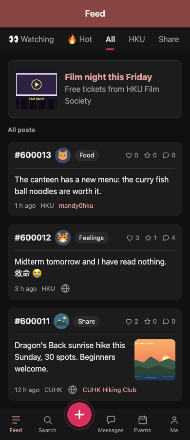

# Responsive layout: build every page for computers and phones

**Decision D22, 21 Oct 2026:** Campus Notes is one desktop-first responsive website. The shared Express/EJS routes, forms and database serve every screen size. The reference app's phone screenshots explain features; they do not restrict the website to a 480 px column.

## What the shared shell owns

- **Desktop, 1024 px and above:** left sidebar navigation beside a wider, centred shell (up to 1280 px). Content can use suitable grids; forms and long text keep a comfortable reading width.
- **Tablet, 768 to 1023 px:** an expanded content column with bottom navigation. Suitable card lists can use two columns; keep controls and filters usable without squeezing a desktop layout into a small space.
- **Phone, below 768 px:** one column with fixed bottom navigation and enough bottom padding to keep the last control visible above it. The compose page can hide the compact tabs; its back link remains available.
- Account navigation may show the signed-in viewer's own handle, including on anonymous post pages (D23). This identifies only the current account; post and participant identities remain anonymous.
- Compact layouts reserve scroll padding above the fixed bottom navigation so native keyboard focus and scroll-to-target behavior keep actions visible.
- The shell supplies the page title, back link, active destination, unread badge, keyboard skip link and navigation. Logged-out pages use a centred form/content layout without authenticated navigation.
- Breakpoints use CSS viewport width. Resizing the same page adapts it immediately; no browser/device detection, duplicated routes or alternate database code.

Keep the existing `res.page(view, { title, tab, back, hideTabs, styles, scripts })` API. `tab` selects the active destination. The compact navigation contains Feed, Search, New post, Messages, Events and Me; Events and My tickets select Events at every width. Its six equal columns retain 44 px targets at 320 px, and the compose circle stays within its column. `hideTabs` hides compact tabs, while a logged-in desktop user can still use the sidebar. Add no module-owned fixed sidebar or bottom bar.

## Layout helpers to reuse

The shared `public/css/kit.css` supplies:

- `page-grid`: a single column below 768 px that becomes two equal columns at tablet and desktop widths. Use it for independent panels, with their narrow-screen reading order reflected in the HTML.
- `page-grid-wide`: a desktop grid (at least 1024 px) with roughly 3:2 primary/supporting columns; one column below that breakpoint.
- `readable`: bounds long text to about 42 rem; use for post bodies and prose.
- `form-width`: bounds forms to about 42 rem; inputs still fill their available column on phones.
- `table-wrap` around `table`: keeps a wide table's horizontal scrolling within that panel.
- `row` with `wrap`: lets filter controls, metadata and action buttons wrap. `post-list` is the shared way to render post cards; it uses two columns from 768 px and one below that.

For example, a detail page may put its detail card and a supporting panel inside `page-grid-wide`; a form page may wrap its form in `form-width`. Keep comments and conversations in one chronological column. More columns are useful only when the content remains easy to read.

## What each module owns

Use the module-specific layout notes in your DEV_GUIDE. Module styles live in `modules/<module>/public/<module>.css`, included through `res.page({ styles: [...] })`. Scope selectors with a module-specific class such as `.content-compose`; do not override `body`, `.page`, `.topbar`, `.tabbar` or `.desktop-sidebar` from a module.

When adding a layout:

1. Use fluid widths (`width: 100%`, `max-width`) rather than a fixed page width. Give grid/flex children `min-width: 0` so long content cannot force them beyond the viewport.
2. Wrap long user text, handles, error messages and links (`overflow-wrap: anywhere` where needed). Images scale to their container; image groups and action rows wrap.
3. Put tables and long tab strips in their own scroll containers. Do not hide document overflow to conceal a broken layout.
4. Keep labels, errors and primary actions visible at every width. Do not make a function hover-only. Preserve the HTML reading and keyboard order when panels stack.
5. Keep ordinary links and form submissions working with JavaScript disabled. JavaScript may enhance counters, previews and fetch forms; CSS alone handles responsive layout and navigation.

If a shared helper needs changing, open a `contract-change` issue for the coordinator rather than editing the shared stylesheet from a module task.

## Acceptance checks for every page

Check normal, empty and validation-error states as the personas in your DEV_GUIDE. Use browser responsive mode at **390 × 844**, **768 × 1024** and **1440 × 900 CSS pixels**, then resize between them. Check 320 px as well for small-phone edge cases when practical.

- [ ] No horizontal **document** overflow. Long text and links wrap; images stay inside their card. Horizontal scrolling is confined to intended tables or tab strips.
- [ ] Desktop sidebar and compact navigation show the correct active destination and unread badge; keyboard users can reach navigation and page content. The relevant back link remains available on pages that hide compact tabs.
- [ ] Forms and prose remain comfortable to read on desktop. The phone uses one column, without clipped fields, covered bottom actions or overlapping cards.
- [ ] Filters, buttons, errors, empty states and image previews fit. Touch targets are at least 44 px high, and the keyboard focus outline is visible.
- [ ] The page still works at 200% browser zoom and with JavaScript disabled. Use the real submit button when autosubmit is unavailable; event release dates remain visible without a live countdown.
- [ ] The PR includes a phone screenshot and a desktop screenshot, and records the tablet check. State what you actually checked; existing phone screenshots are not proof of the new desktop layout.

Run your module tests, `npm test` and `npm run lint` as usual. HTTP tests verify behavior and markup; they do not replace these browser layout checks. Follow [WORKFLOW.md](../team/WORKFLOW.md) for the PR checklist.

## Reference views

The 27 Oct review update keeps Events in the compact navigation alongside Feed, Search, New post, Messages and Me. The same Feed works without JavaScript at both sizes; tablet and breakpoint checks are recorded in [validation](../team/VALIDATION.md).

[Desktop Feed at 1440 px, 27 Oct](screenshots/review-desktop-feed.png)

These are screenshots of the same Events page with seed data, captured on 21 Oct 2026. The layout changes with viewport width.

[Tablet Events at 768 px](screenshots/tablet-events.png)

