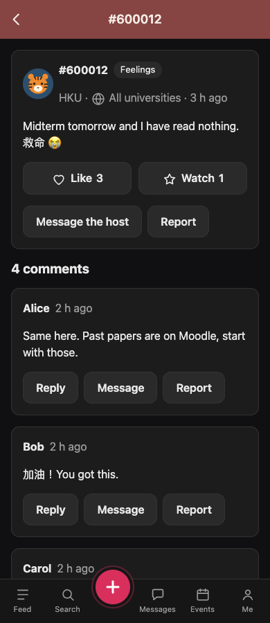

# Posts and comments: user guide

Campus Notes is a tree hole: you write short notes, anonymously unless you choose otherwise, and other students reply under nicknames that belong to that one post. This guide covers writing a post, reading and commenting, likes and watching, deleting, your history and your comments.

Screenshots below use local demo accounts. Watching/History lists, private messages, reports and notification screens are integrated with Discover and Messages. See the [current app validation](../../team/VALIDATION.md) for recorded results and limits.

**On a computer or phone:** Campus Notes is a responsive website. When logged in, use the left sidebar on desktop or the bottom tabs on tablets and phones. The same destinations and actions are available at every width. Compose and reply forms stay at a comfortable reading width; post images fit the screen and action buttons wrap. These instructions use “tap” for either clicking or tapping. See [the responsive layout guide](../../architecture/RESPONSIVE.md) for viewport details.

## 1. Writing a post

Select **New post** in the desktop sidebar, or tap the pink **+** button in the compact tab bar.

1. Type your note: up to 750 characters, in any language. The counter under the box shows how many characters are left.
2. Optionally tap **Images** and choose up to 6 photos (JPEG, PNG, WebP or GIF, at most 5 MB each). They appear in the order you chose them. If a photo is refused, the page says why and keeps everything else you wrote; only the photos need choosing again.
3. Set the two switches:

   | Switch | Off (the usual default) | On |
   |---|---|---|
   | **Show my handle** | Your post is anonymous: nobody can see who wrote it. | Your handle (such as `mandy0hku`) appears on the post and links to your page. An organization shows its name. |
   | **Visible to all universities** | Only students of your university can see the post. | Students of every university on Campus Notes can see it. |

   The switches start from your choices in **Me → Settings**, so you can set your usual preference once.
4. Pick one topic: Share, Random, Feelings, Academics, Careers, Trade or Food. A topic is required.
5. Tap **Publish**. You see "Posted" and your new post's page, with its number (such as #600015).

Posts cannot be edited after publishing. If you made a mistake, delete the post and write it again.

If you start typing and then leave the page, Campus Notes asks "Leave and discard this draft?". Choose **Keep editing** to keep writing; drafts are not saved.

Each post gets a random animal avatar, so even your picture does not give you away.

[Phone compose](img/compose-390.png) · [Validation errors on phone](img/compose-error-390.png)

## 2. Reading a post

Tap any post in the feed, in search results or in a notification. The post page shows:

- the post's avatar, its number (#600012), its topic, how long ago it was posted and the writer's university;
- a globe and **All universities** when the post is shared across campuses; the writer's university still identifies where the post came from, not an audience restriction;
- the writer's handle, only if they chose **Show my handle**;
- the text and the images (tap an image to see it full size);
- the **heart** (like) and **star** (watch) buttons with their counts;
- **Message the host** and **Report**;
- the comments, oldest first, and a box to add yours.

If a post was deleted, hidden by a moderator, or shared only with another university, its page says "This page does not exist or you cannot see it".

[Desktop post](img/post-1440.png) · [Tablet post](img/post-768.png)

## 3. Comments and aliases

Nobody's handle appears in comments. Instead, everyone has a nickname (an alias) on each post:

| Name | Who |
|---|---|
| **Host** (highlighted) | The person who wrote the post. |
| **Alice** | The first other person who commented. |
| **Bob**, **Carol**, **Dave**, ... | The next people, in the order of their first comment. After Zoe come "Alice 2", "Bob 2", and so on. |

Your alias stays the same for every comment you write on that post, even if you delete your comments, and it is never given to anyone else. On another post you get a new one. Above the comment box you can see how you will appear: "You will appear as Host", "You will appear as Alice", or "You will appear under a new alias" before your first comment.

- **Comment:** type in the box at the bottom (up to 500 characters) and tap **Send**. The page jumps to your new comment.
- **Reply:** tap **Reply** under a comment. The box shows "Replying to Bob"; tap **Cancel** to make it a normal comment again. Your comment then says "replying to Bob", and Bob gets a notification.
- **Message:** tap **Message** under someone's comment to write to them privately. You both stay anonymous: they see you under your alias on this post.
- **Report:** tap **Report** under a comment that breaks the rules.
- **Delete:** tap **Delete** under your own comment and confirm.

What the labels mean:

| Label | Meaning |
|---|---|
| replying to Bob | This comment answers one of Bob's comments; tap it to jump there. |
| [deleted] | The writer deleted this comment. It keeps its place so the replies still make sense. |
| [hidden by a moderator] | A moderator hid this comment after a report. |
| (you) | You wrote this comment. |

The post's writer, and everyone watching the post, are told about new comments in **Messages → Notifications**.

The post screenshot above includes the flat thread, Host label, reply links and hidden-comment placeholder.

## 4. Likes and watching

| Button | What it does |
|---|---|
| ♥ **Like** | Shows the writer you liked it (they get one notification) and helps the post reach the 🔥 Hot tab. Tap again to unlike. |
| ★ **Watch** | Saves the post to **Me → Watching** and tells you about every new comment on it. Tap again to stop watching. |

You can do both on the same post. Tapping twice quickly does no harm.

## 5. Messaging the host and reporting a post

- **Message the host** starts a private conversation with the post's writer. They see you as "Visitor" (or your alias, if you have commented), and you see them as "Host". It is not shown on your own posts.
- **Report** sends the post to the moderators with a reason. It is not shown on your own posts.

Both open pages of the Messages tab; see the Messages user guide.

## 6. Deleting

- **Your post:** open it, tap **Delete post** and confirm. You see "Post deleted" and the feed. The post disappears from every list and its page no longer opens, for you too.
- **Your comment:** tap **Delete** under it and confirm. It shows as "[deleted]" for everyone.

Deleting cannot be undone. You can only delete what you wrote.

## 7. Your history

Every post you open is added to **Me → History**, newest first. To erase it, open History and tap **Clear history**; you see "History cleared" and the list is empty. A post you open again after that comes back into your history. Clearing only empties your own list: it does not undo your visits to other people's posts. Nobody else can see your history.

## 8. My comments

**Me → My comments** lists every comment you wrote, newest first, with the name you had on that post ("as Alice", or "as Host" on your own posts), the post's number and its first words. Tap one to jump straight to it. Tap **Load more** at the bottom for older ones.

Deleted comments are not listed, and neither are comments on posts that were deleted or hidden. A comment a moderator hid shows "[hidden by a moderator]".

## 9. Who can see what

| Your choice | Who can open the post | What they see about you |
|---|---|---|
| Anonymous, my university (the default) | Students of your university | Nothing: avatar, topic, time and your university only |
| Anonymous, all universities | Everyone on Campus Notes | Nothing |
| Show my handle, my university | Students of your university | Your handle, linking to your page |
| Show my handle, all universities | Everyone on Campus Notes | Your handle, linking to your page |

In comments you always appear under your alias, never your handle, whatever you chose for your own posts.

## 10. Messages you may see

| Message | Why |
|---|---|
| Posted | Your post is published. |
| Pick a topic | Every post needs one of the seven topics. |
| Your post cannot be blank | The text box is empty or holds only spaces. |
| Your post is too long (at most 750 characters) | Shorten it; the counter shows how much. |
| Please add your images again. | The post was not published because of another error, and your browser does not keep chosen photos. |
| Up to 6 images, JPEG, PNG, WebP or GIF, 5 MB each. | One of the files is the wrong type or too large, or you chose more than 6. Your text, topic and switches are kept; choose the images again. |
| Your comment cannot be blank / Your comment is too long (at most 500 characters) | Fix the comment and send it again; your text is kept. |
| You can only reply to a visible comment | The comment you were replying to was deleted or hidden while you were typing. Send yours as a normal comment. |
| Leave and discard this draft? | You are leaving the compose page with unsent text. |
| Delete this post? This cannot be undone. / Delete this comment? | Confirm before deleting. |
| Post deleted / Comment deleted / History cleared | Done. |
| This page does not exist or you cannot see it | The post was deleted or hidden, or it is shared only with another university. |

## 11. Try it with the demo accounts

All demo accounts use the password `campus123` (in development, the login page lets you pick one).

1. Log in as **mandy0hku** → **+** → write a note, add a photo, pick **Trade**, leave both switches off → **Publish**. You are on post #600015.
2. Log in as **wing0cuhk** (CUHK) and open `/posts/600015`: it does not exist for her, because Mandy's post is for HKU only.
3. Log in as **newbie0hk** → open #600012 ("Midterm tomorrow...") → the box says "You will appear under a new alias" → comment. You are **Dave**, because Alice, Bob and Carol already commented. Tap **Reply** under Bob's comment and reply: it says "replying to Bob".
4. Still as Newbie, tap the **star** on #600003, then open **Me → Watching**: the post is there.
5. Log in as **kelvin0hk**, the anonymous writer of #600012: his comment shows as **Host**, his handle is hidden from the post and comments (his own account sidebar still names him), and **Messages → Notifications** says Dave commented on his post.
6. Log in as **mandy0hku** → **Me → My comments**: four comments, three as Alice and one as Host (on her own library post #600001).
7. Log in as **jason0ust** → **Me → My comments**: his rude comment on #600012 shows "[hidden by a moderator]".
8. As **mandy0hku**, open **Me → History** → **Clear history**: the list is empty.

## 12. Full-screen images

Tap a post image to open the viewer. Use **Previous** and **Next**, the keyboard left/right arrows, or a horizontal swipe on a touch screen to move between images. The counter shows your position, such as “Image 1 of 2”. Navigation stops at the first and last image; both navigation buttons are disabled for a single image.

Use **Close** or **Escape** to return to the same position in the post. Keyboard focus returns to the image you opened; Tab and Shift+Tab stay inside the viewer while it is open. **Open original** opens the file in a new tab. If an image fails to load, an error message and the original-file link remain available.

Without JavaScript, selecting an image opens its original file directly; use the browser Back button to return. Posting, replying, liking, watching and deleting also continue to work as ordinary forms without JavaScript. Interactive confirmation and draft-leaving prompts require JavaScript.

[Desktop image viewer](img/viewer-desktop.png)
