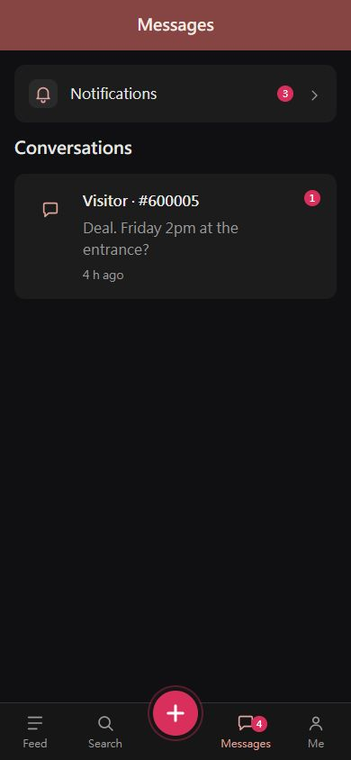
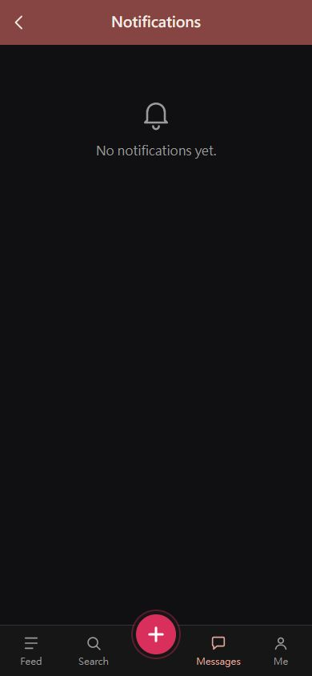
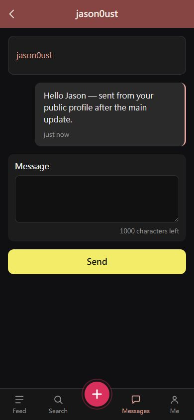
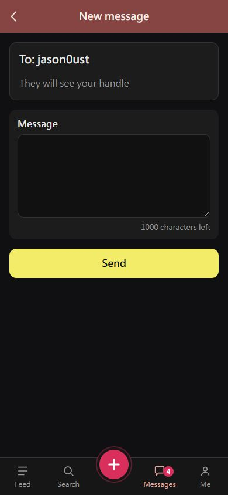
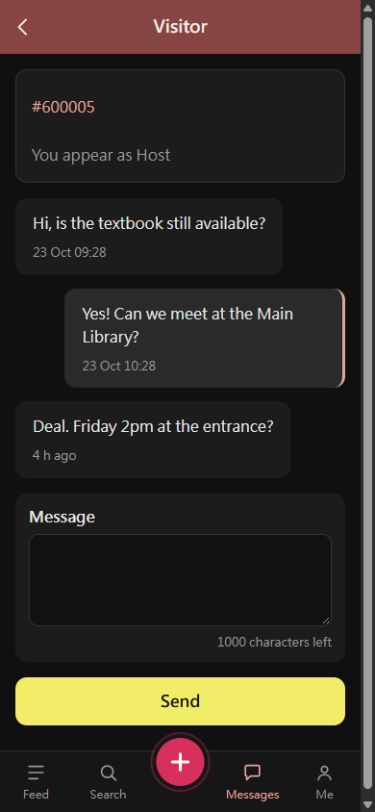
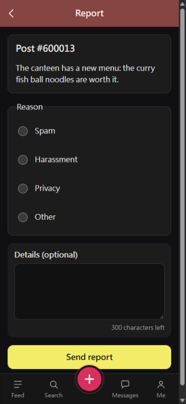
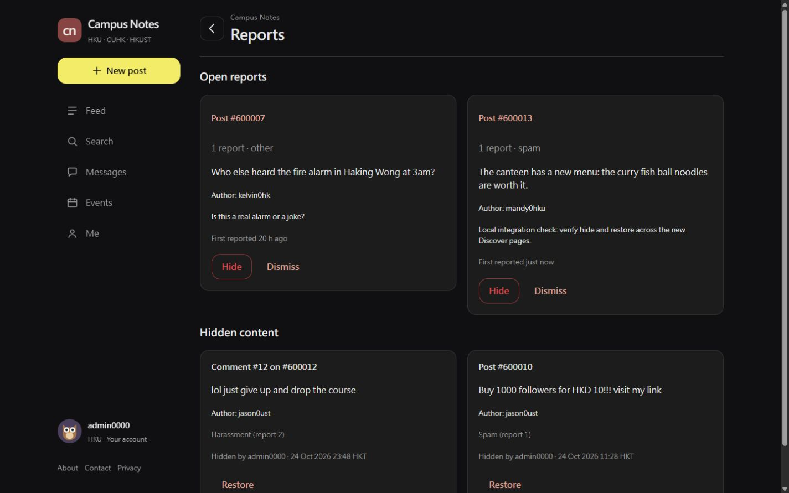

# Messages: user guide

The **Messages** tab is your inbox. It tells you when people react to your posts and comments, lets you talk privately with another student, and is where you report posts or comments that break the rules. Admins also use it to review reports.

**Local implementation, synchronized 25 Oct 2026 to main `f9e8f68`:** MS-1 to MS-7 are available, including the working Discover public-profile links. MS-8 block/unblock controls are planned, not included. See [local acceptance steps](LOCAL_ACCEPTANCE.md), [main adaptation](MAIN_ADAPTATION.md) and [validation results](VALIDATION.md). Published screenshots show the synchronized app on 25 Oct; historical images remain in the local backup.

**On a computer or phone:** Campus Notes is a responsive website. When logged in, use the left sidebar on desktop or the bottom tabs on tablets and phones. The same destinations and actions are available at every width. Conversations keep their chronological reading order, and long messages wrap to fit the screen. These instructions use “tap” for either clicking or tapping. See [the responsive layout guide](../../architecture/RESPONSIVE.md) for viewport details.

## 1. The Messages tab

The number on the **Messages** tab is everything you have not seen yet: new notifications plus unread private messages. It disappears when you have read everything. Pages refresh when you open them; there is no live push, so open the tab again to check for news.

Tap the tab to see:

- **Notifications** at the top, with the number of new ones.
- **Your conversations** below, the most recent first. Each shows who you are talking to, the last message ("You: ..." if it was yours), when it was sent, and a red number for unread messages.

If you have not talked to anyone yet, you see "No conversations yet."

[Desktop Messages screenshot](screenshots/adapt-home-1440.jpg)

## 2. Notifications

Open **Messages → Notifications**. You are told when:

| You see | It means |
|---|---|
| Alice commented on your post #600012: “...” | Someone commented on a post you wrote. |
| Alice replied to your comment on #600012: “...” | Someone answered one of your comments. |
| Alice commented on #600004, which you watch: “...” | Someone commented on a post you saved with the star. |
| Your post #600004 got a like | Someone liked your post. You are not told who. |
| This post is no longer available | The post was deleted by its author or hidden by a moderator. |

- People appear under their **alias on that post** (Host for the post's author, then Alice, Bob, Carol, ...), exactly as in the comment thread. Notifications never reveal who someone is.
- You are told about each comment once, even if it is a reply to you on a post you also watch, and never about your own comments.
- Liking, unliking and liking again only tells the author once.
- New notifications are highlighted. Opening the list marks them all as read.
- Tap a notification to jump to that comment on the post.
- If a comment was deleted or hidden after the notification, it shows "[deleted]" or "[hidden by a moderator]" instead of the text.
- Don't want them? **Me → Settings** has switches for comment notifications and like notifications.

## 3. Private messages

### Starting a conversation

| From | Tap | You talk to | Names shown |
|---|---|---|---|
| A post | **Message the host** | the post's author | You both stay anonymous: they are "Host"; you are your alias on that post, or "Visitor" if you never commented there. |
| A comment | **Message** on that comment | the person who wrote it | Their alias on that post (such as "Alice"); you are your alias there, or "Visitor". |
| A user's page | **Message** | that user | Handles (or the organization's name), on both sides. |

Write your first message and tap **Send**. The page tells you how you will appear ("You will appear as Visitor", or "They will see your handle") before you send anything.

- If you already have a conversation with that person about the same post (or by handle), you go straight back to it: there is only one conversation per pair of people per post, plus one by handle.
- A conversation about a post and a conversation by handle with the same person are separate, so nobody can work out which handle is behind an alias.
- You can only message about posts you can see.
- Post conversations have a **Chat #** reference in the inbox and conversation page. Use it to distinguish two Visitors on the same post. The reference belongs to that private conversation; it does not identify a person across other chats or posts. Sending a DM does not give you a public comment alias.

The **Message** button on a public student or organization profile opens the same Messages module. It is absent on your own profile and on a banned user's profile. In a public conversation, tap the other person's name to return to their profile. Opening Message again reuses the conversation.

[Desktop public profile with the Message entry](screenshots/adapt-profile-1440.jpg)

### Talking

Open a conversation from **Messages**. Your messages are on the right, theirs on the left, each with its time. The top shows who you are talking to and, for a conversation about a post, a link to the post and how you appear ("You appear as Host"). Opening a conversation marks it as read. Messages can be up to 1,000 characters. Only the two of you can read or write in it.

### Blocking a conversation (MS-8, planned)

The Block and Unblock controls are not part of this local MS-1 to MS-7 delivery. The future design is described in the developer guide. Existing block records are respected by sending checks, and existing messages remain readable.

Use the report flow in section 4 for abusive posts or comments.

## 4. Reporting a post or comment

See something that breaks the rules? On the post, tap **Report** (for the post) or **Report** under a comment.

1. Pick a reason: **Spam**, **Harassment**, **Privacy** (it reveals personal information) or **Other**.
2. Optionally add details (up to 300 characters).
3. Tap **Send report**. You see "Thanks. A moderator will review it."

You can report each post or comment once. You cannot report your own. The person you report is not told who reported them.

## 5. For admins: the report queue

Open **Me → Reports**.

- **Open reports** lists each reported post or comment once, oldest first, with how many people reported it, their reasons and details, the text (even if the author has since deleted it) and the author's handle, so you can spot repeat offenders.
- **Hide** removes the post or comment for everyone and closes every report on it. A hidden post disappears from every list and its page no longer opens; a hidden comment keeps its place in the thread as "[hidden by a moderator]".
- **Dismiss** closes the reports without hiding anything.
- **Hidden content** lists everything currently hidden, with the reason and who hid it. **Restore** brings it back for everyone; its reports stay closed.

## 6. Messages you may see

| Message | Why |
|---|---|
| This post is no longer available | (Notifications) The post was deleted or hidden. |
| You cannot message yourself | The post, comment or page you started from is your own. |
| This page does not exist or you cannot see it | The post is not visible to you, it was deleted or hidden, the user does not exist, or the conversation is not yours. |
| Your message cannot be blank / Your message is too long (at most 1000 characters) | Messages need 1 to 1,000 characters. |
| Thanks. A moderator will review it. | Your report was sent. |
| You have already reported this | One report per person per post or comment. |
| You cannot report your own post / You cannot report your own comment | Reports are for other people's content. |
| Pick a reason | A report needs a reason. |
| You blocked this conversation. Unblock to reply. | You blocked this conversation; nobody can send in it until you unblock it. |
| You can no longer reply in this conversation. | The other person blocked this conversation. |
| Hidden. 2 reports resolved. / Dismissed. 1 report resolved. / Restored. | (Admins) What your action did. |

## 7. Try it with the demo accounts

All demo accounts use the password `campus123` (in development, the login page lets you pick one).

1. Log in as **mandy0hku**: the Messages tab shows **4** (3 new notifications and 1 unread message). Open **Notifications**: the three newest, at the top, are highlighted: "Host replied to your comment on #600012" and two "which you watch" rows about #600012. Go back: the Notifications count is gone and the tab shows 1.
2. Still as Mandy, open the conversation "Visitor · #600005": a student is asking about her textbook. She cannot see who it is, only "Visitor". Reply "Friday 2pm works."
3. Log in as **kelvin0hk**: the conversation shows "Host · #600005" with Mandy's new reply unread.
4. Log in as **newbie0hk** → Feed → open #600001 → **Message the host** → send a question. Log back in as Mandy: a new conversation "Visitor · #600001" is at the top.
5. Log in as **wing0cuhk** → open #600012 → **Message** on Alice's comment: Wing appears as "Bob", Mandy as "Alice". Try `/messages/new?post=600001` as Wing: the HKU-only post is not found.
6. Log in as **newbie0hk** → open #600007 → **Report** → Spam → **Send report**.
7. Log in as **admin0000** → Me → **Reports**: #600007 has 2 reports and shows its author's handle. Tap **Hide**: the post disappears for everyone. Under **Hidden content**, **Restore** would bring back the spam post #600010; its old report stays closed.
8. Log in as **newbie0hk** and open `/messages/c/1`: the conversation is not found. Open `/admin/reports`: access is forbidden. These checks must not expose private messages or change moderation data.
